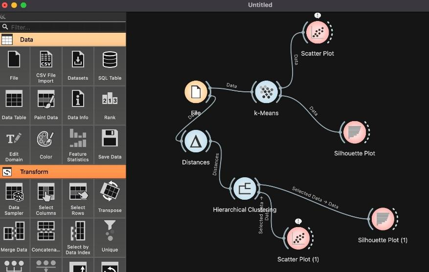
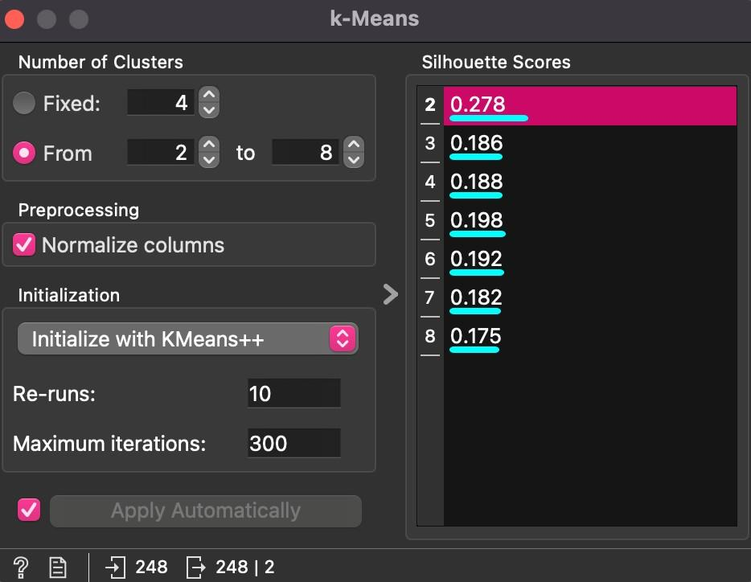
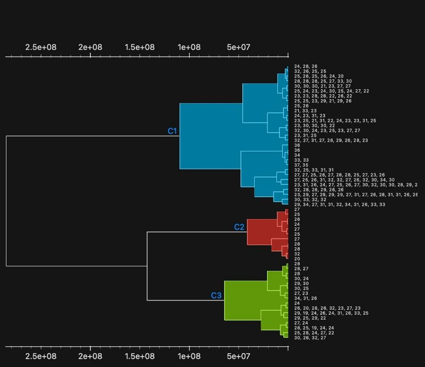
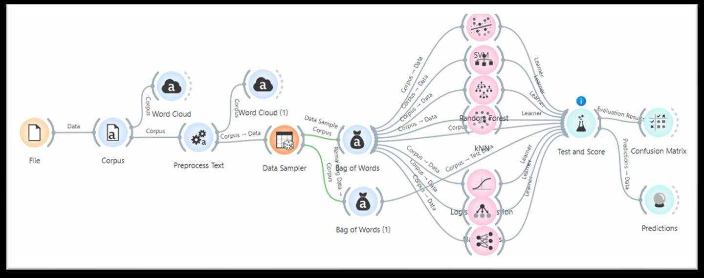
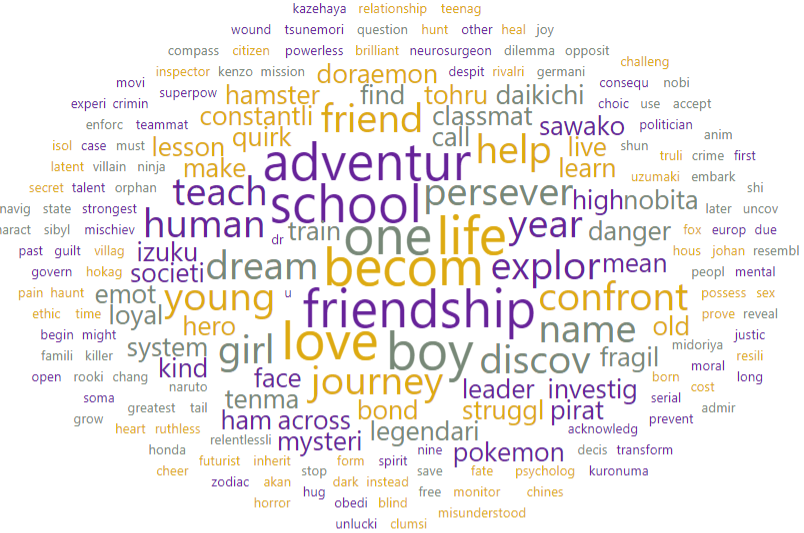
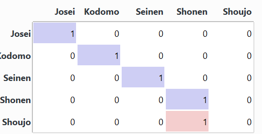

# Supervised & Unsupervised Learning with Orange

Academic project done during my 2nd year of MIASHS at Université Paul-Valéry Montpellier 3 (November 2025), for the Data Science course.

I built two independent machine learning pipelines in [Orange Data Mining](https://orangedatamining.com/):

- **Unsupervised**: grouping 248 FIFA 20 players into profiles from their stats (K-Means vs hierarchical clustering)
- **Supervised**: predicting the target audience genre of an anime (Shonen, Seinen, Shoujo, Josei, Kodomo) from its synopsis, with text mining and 7 classifiers

## 1. Unsupervised learning — FIFA 20 player profiles

### Data

248 professional players from FIFA 20 (Kaggle). Clustering works on distances, so I dropped every text column (name, nationality, league, position) and kept 12 numeric features: age, height, weight, overall rating, market value, skill moves, pace, shooting, passing, dribbling, defending and physical. The 8 goalkeepers have no outfield stats, so these values are missing for them.



### K-Means

- Columns normalized, so that market value (in euros) does not dominate the distance
- k tested from 2 to 8, KMeans++ initialization, 10 re-runs
- Best silhouette score for **k = 2 (0.278)**



The two clusters roughly split technical / attacking players (high dribbling and pace) from physical / defensive players (taller, higher defending). The low silhouette shows many hybrid profiles sitting between the two groups.

### Hierarchical clustering

- Euclidean distance, Ward linkage
- Dendrogram cut into 3 clusters, with silhouettes mostly between 0.3 and 0.6



### Looking back

The hierarchical branch was run on **non-normalized** data, so the Euclidean distance is driven almost entirely by market value (up to €105M). You can see it on the dendrogram axis, which goes up to 2.5e+08. The 3 clusters are in fact market value tiers (below €42M, €42–69M, above €72M), which explains the high silhouette.

Re-running Ward on standardized data (quick check with scikit-learn) gives a silhouette around 0.18, below K-Means. So the conclusion of the submitted report (hierarchical clustering beats K-Means) does not hold. The fix is to normalize the data the same way in both pipelines before comparing them.

## 2. Supervised learning — anime genre from the synopsis

### Data

I started from the MyAnimeList dataset on Kaggle (60,000+ titles) and kept a small balanced sample, as recommended by my teacher: **25 anime, 5 per genre**, each with an English synopsis of about 50–65 words.

| Genre | Typical themes | Audience |
|---|---|---|
| Shonen | Action, adventure, friendship | Teenagers / general |
| Seinen | Realism, mystery, psychology | Adults |
| Shoujo | Romance, daily life, emotions | Teenagers / general |
| Josei | Romance, drama, work life | Adults |
| Kodomo | Kids, humor, education | Children |

### Pipeline



1. **Corpus**: the synopsis is the text feature, the genre is the target
2. **Preprocess Text**: lowercase, regex tokenization, English stopwords and punctuation removed, stemming
3. **Data Sampler**: stratified split, 20 synopses for training and 5 for testing. I first tried 10/3, but kNN (k = 5) could not run with so few examples.
4. **Bag of Words** (word counts), applied separately to the training set and the test set
5. **7 learners**: Logistic Regression, SVM, Naive Bayes, Decision Tree, Random Forest, kNN and Neural Network
6. **Test and Score** on the held-out test set, then Confusion Matrix and Predictions



### Results on the test set

| Model | AUC | Accuracy | F1 | MCC |
|---|---|---|---|---|
| **Logistic Regression** | **1.000** | **0.800** | **0.733** | **0.791** |
| Naive Bayes | 0.950 | 0.600 | 0.500 | 0.598 |
| SVM | 0.850 | 0.600 | 0.467 | 0.559 |
| Decision Tree | 0.775 | 0.600 | 0.500 | 0.598 |
| kNN | 0.775 | 0.600 | 0.533 | 0.527 |
| Neural Network | 0.700 | 0.600 | 0.533 | 0.527 |
| Random Forest | 0.825 | 0.400 | 0.267 | 0.280 |

Logistic Regression is the best model: 4 synopses out of 5 are correctly classified. Its only error is a Shoujo synopsis predicted as Shonen.



The other models mostly confuse genres that share vocabulary but differ in tone: Josei and Seinen predicted as Shonen, or Shoujo predicted as Kodomo (school, friendship, family...). A bag of words only counts words, so it cannot capture the mature or childish tone of a story.

### Limitations

- With only 5 test synopses, each error costs 20 points of accuracy. These scores are indicative only; cross-validation on a much larger corpus would be needed.
- Next steps: TF-IDF weighting, n-grams, or sentence embeddings to capture context.

## Repository content

```
data/
  fifa20_raw.csv               original extract (names, nationality, league, position...)
  fifa20_clean.csv             numeric features used for clustering
  anime_synopsis_genres.csv    25 anime: title, genre, synopsis
workflows/
  fifa20_clustering.ows        Orange workflow, unsupervised part
  anime_genre_classification.ows   Orange workflow, supervised part
images/                        screenshots of the workflows and results
report/                        full project report (in French)
```

## How to open the workflows

1. Install [Orange](https://orangedatamining.com/download/) and the **Text** add-on (Options → Add-ons → Text)
2. Open a `.ows` file from `workflows/`
3. In the **File** widget, select the matching CSV from `data/`

## Context

L2 MIASHS, Université Paul-Valéry Montpellier 3 — Data Science course taught by Mme Khiari. Pair assignment with Moatacem Haki.

**Tools:** Orange 3, Orange3-Text add-on
